# Windy Origins

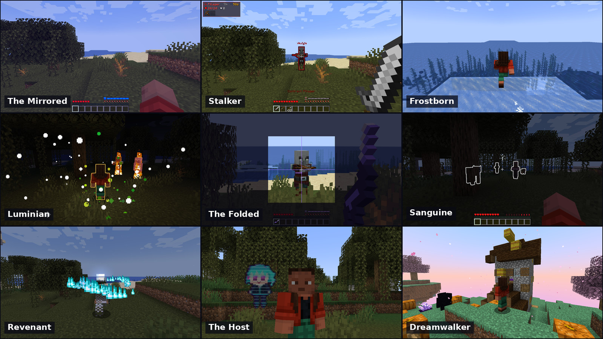

An **Origins** add-on for Minecraft with nine origins. It runs on **1.19.4, 1.20.1, 1.20.2 and
1.20.4**, on Fabric and Quilt, and on **Forge and NeoForge** for 1.20.1. It began as
*Mirrored Origin*, a mod with a single origin; the Mirrored is still here, joined by eight more.

| Origin | In one line |
|---|---|
| **Mirrored** | Lives in an empty reflection of the world and can bear reality only seconds at a time. A pacifist: the mirror returns every blow it deals. |
| **Stalker** (bounty hunter) | Marks one target and is deadly to it alone; slow and fragile without a contract. |
| **Frostborn** | Carries the cold: freezes water underfoot (and under a boat), chills enemies, seals itself in ice. |
| **Luminian** | A living light. Cannot hide, burns the undead, rises once from death at dawn. |
| **Folded** | Born in a pocket of space. Hovers, and carries a hitscan rifle that pierces armour. |
| **Sanguine** | A vampire. Blood is its hunger bar, and every kind of blood grants a different trait. |
| **Revenant** | A soul that will not leave. Possesses creatures, sends wisps on errands, takes ten seconds of vengeance after death. |
| **Host** | Has a chip in the temple and Volta in the chip: a companion who fights, scouts and works on request, overheats, plays pranks and can break. Asked to, she takes the Host's body and walks, mines, crafts, hunts, fights and travels with it: "Volta, take the body and go find diamonds". |
| **Dreamwalker** | Puts creatures to sleep and walks into their dreams. |

Every power is described in game on the origin selection screen, in ten languages: English,
Russian, Ukrainian, German, Spanish, French, Polish, Brazilian Portuguese, Japanese and
Simplified Chinese.

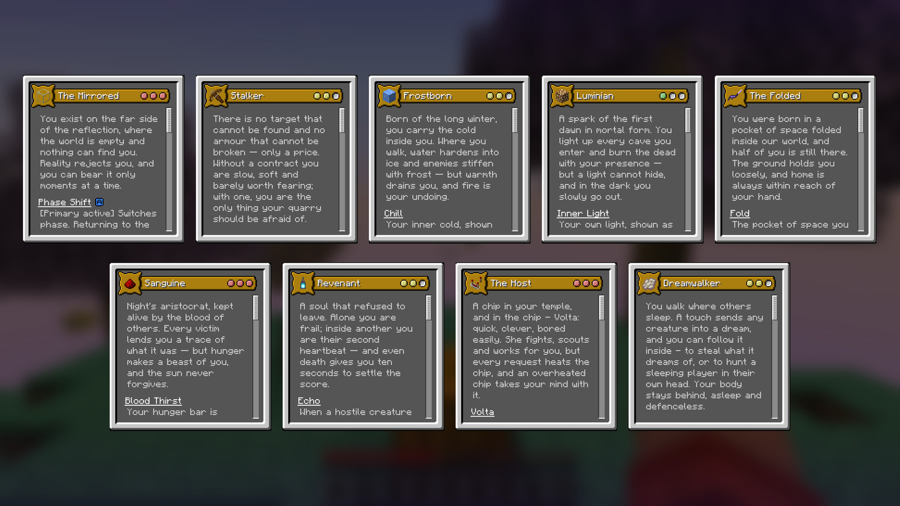

Downloads are on the [releases page](https://github.com/KiaOnigiri/WindyOrigins/releases).

## A few of them

| | |
|---|---|
| 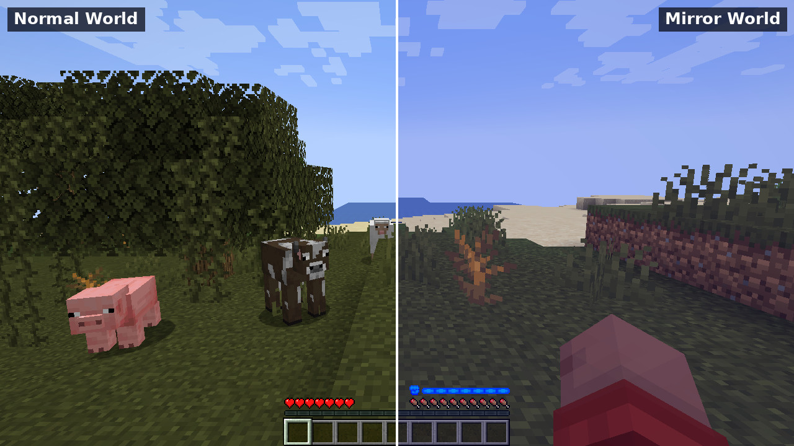 | 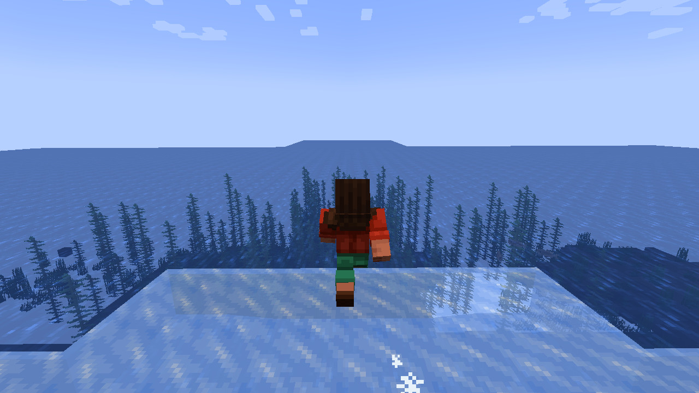 |
| **The Mirrored.** The same spot in the world and in its empty reflection. | **Frostborn.** Water hardens underfoot, wider the colder you are. |
| 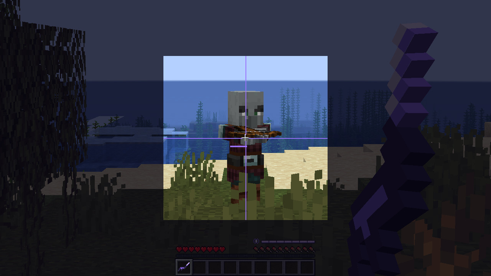 | 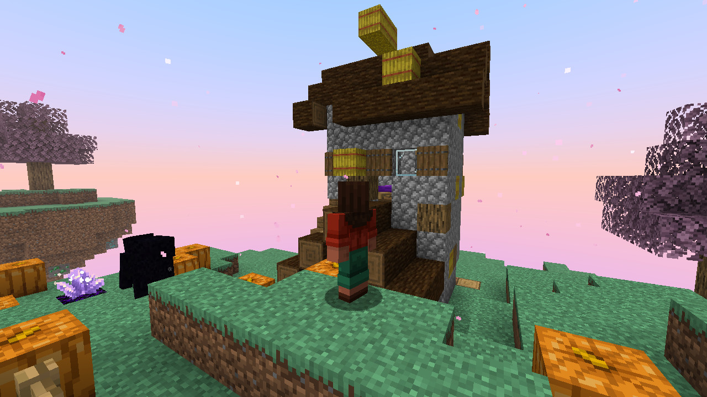 |
| **The Folded.** The Fold Rifle through its scope: a hitscan shot, no travel time and no drop. | **Dreamwalker.** Inside a villager's dream: a floating island of its world, reveries to steal and a nightmare guarding them. |

## The Host and Volta

Volta lives in the chip in the Host's temple: a hologram everyone can see, quick, clever and
easily bored.

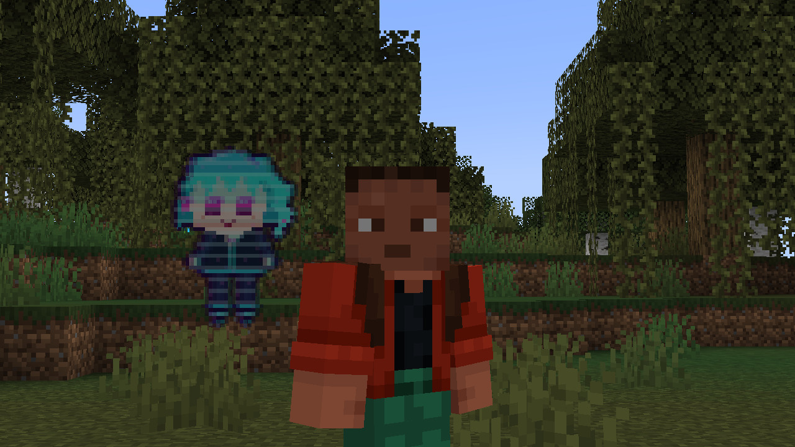

- **Thirty commands on a wheel**, or just talk to her in chat: "Volta, shock that zombie",
  "Volta, build a bridge", "Volta, bring me 64 stone from the chest". She understands ten
  languages.
- **Every request heats the chip.** An overheated chip takes the Host's mind with it, and a hard
  blow can crack the chip outright.
- **She has a will of her own**: leave her idle and she plays pranks.

| | |
|---|---|
| 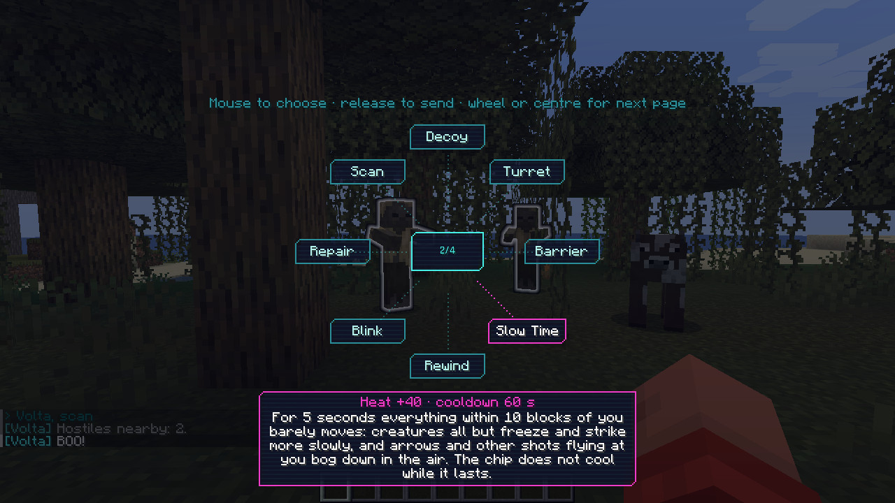 | 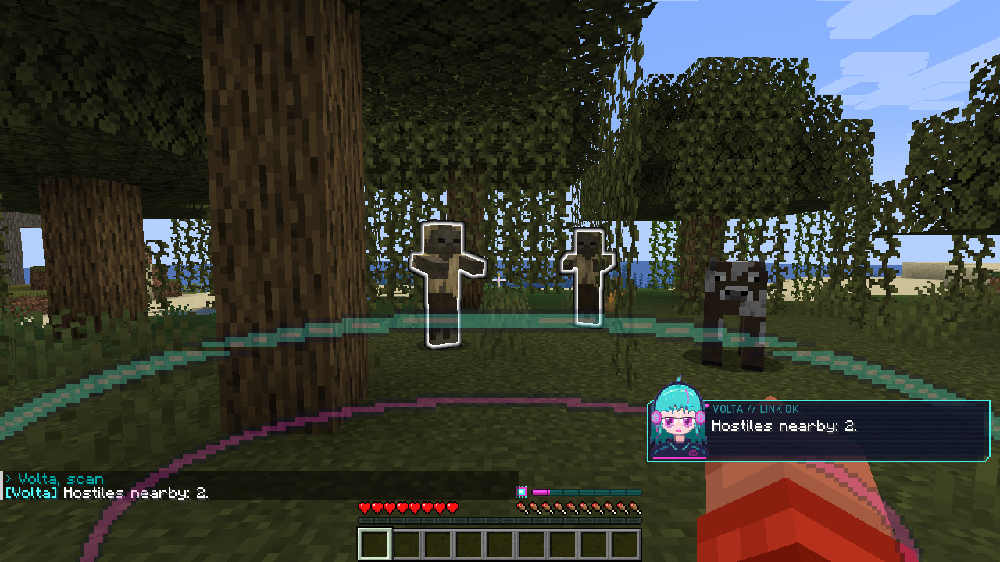 |

### Autopilot: she takes the body

Say **"Volta, take the body and go find diamonds"** and she does it with your hands, your tools
and your weapons, at a player's pace, pressing the same keys a player has. No x-ray and no
teleporting: ore is looked for down a staircase, places on foot.

- **Mines, chops, farms and crafts**: works out recipes of any mod, makes the parts first, goes
  round the chests for what is missing, smelts. Sows the bare beds, tills a trodden one again,
  cuts crops with whatever has the most Fortune on it.
- **Gets about like a player in a hurry**: sprint-jumps, parkours over gaps, bridges forwards
  and backwards, rows a boat (on ice too), rides your horse, takes rails in a minecart, flies
  your elytra on your rockets.
- **Fights**: picks the weapon, shoots a bow, raises the shield, eats and backs off when hurt.
  Against players she reads the other's attack bar, blocks and answers, takes an axe to a
  shield, throws pearls and potions, sets cobwebs. One who climbs out of reach or walls himself
  in gets an arrow, or has the block broken from under him.
- **Several things in one breath**: "harvest the crops and put them in the chest", "kill Steve,
  then set the respawn point".
- **The chip cooks in about 45 seconds of work.** She lets go just before it does and remembers
  the job; "carry on" picks it up again. Any movement key takes the body back at once.

| | |
|---|---|
| 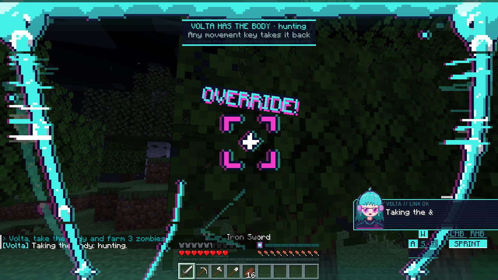 | 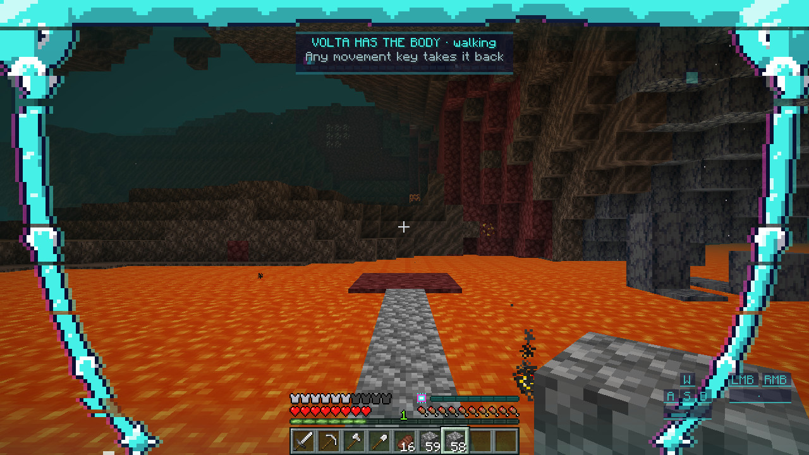 |

## Which file do I need

Each release carries one jar per Minecraft version. The mod is needed on the server and on every
client, and the jar is the same on every loader that version supports.

| Minecraft | File | Loaders | Origins |
|---|---|---|---|
| 1.20.1 | `WindyOrigins-<version>+mc1.20.1.jar` | Fabric, Quilt, Forge, NeoForge | 1.10.0 or newer |
| 1.20.4 | `WindyOrigins-<version>+mc1.20.4.jar` | Fabric, Quilt | 1.13.0-alpha.4 |
| 1.20.2 | `WindyOrigins-<version>+mc1.20.2.jar` | Fabric, Quilt | 1.12.10 |
| 1.19.4 | `WindyOrigins-<version>+mc1.19.4.jar` | Fabric, Quilt | 1.9.0 |

There is no build for a Minecraft version that Origins itself does not exist for. Origins for
1.21.1 is still a pre-release with a reworked API; a port to it is not done yet.

### Fabric and Quilt

| Dependency | Version |
|---|---|
| Fabric Loader | 0.15.0+ (or a current Quilt Loader) |
| Fabric API | any for your Minecraft version |
| Origins | see the table above |
| Java | 17+ |

Apoli and Calio come bundled with Origins.

### Forge and NeoForge (1.20.1)

On Forge the mod runs the same way Origins 1.10.1+ itself does: through
[Sinytra Connector](https://modrinth.com/mod/connector). Put these into `mods`:

| Mod | Tested with |
|---|---|
| Forge | 47.4.10 (NeoForge 47.1.106) |
| Sinytra Connector | 1.0.0-beta.49+1.20.1 |
| Forgified Fabric API | 0.92.6+1.11.15+1.20.1 |
| Connector Extras | 1.11.2+1.20.1 |
| Origins | 1.10.2+mc.1.20.1 (the file marked for Forge) |
| Windy Origins | the `+mc1.20.1` jar |

Connector Extras is not optional here: without it Origins' own reach library fails on current
Forge builds and the game does not start. Do not install the regular Fabric API next to the
Forgified one.

## Building

```
./gradlew build
```

The mod jar is written to `build/libs/`. The `main` branch is the 1.20.1 build; the other
Minecraft versions live on the branches `mc/1.19.4`, `mc/1.20.2` and `mc/1.20.4`, which carry
the same mod with the changes that version of the game needs. On `main` all dependencies are
resolved from Maven repositories. On the version branches Origins is not available from Maven,
so the build downloads the released Origins jar once into `libs/` (checked against a checksum)
and compiles against it.

## About this source tree

From version 1.1.0 on, the sources were rebuilt from the released 1.0.0 jar with a decompiler
(Vineflower, Yarn names) and developed further from there. Code that dates from 1.0.0 therefore
has machine-generated local variable names (`var1`, `var2`); code written since has ordinary
names. The original, hand-written sources of the first Mirrored Origin release are kept in this
repository's history, and its README is preserved as
[`docs/MIRRORED_ORIGIN_1.0.md`](docs/MIRRORED_ORIGIN_1.0.md), which still explains how the two
phases of the world work.

## License

[MIT](LICENSE).
